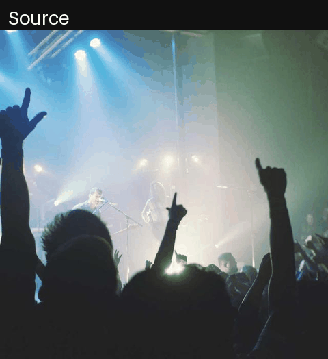
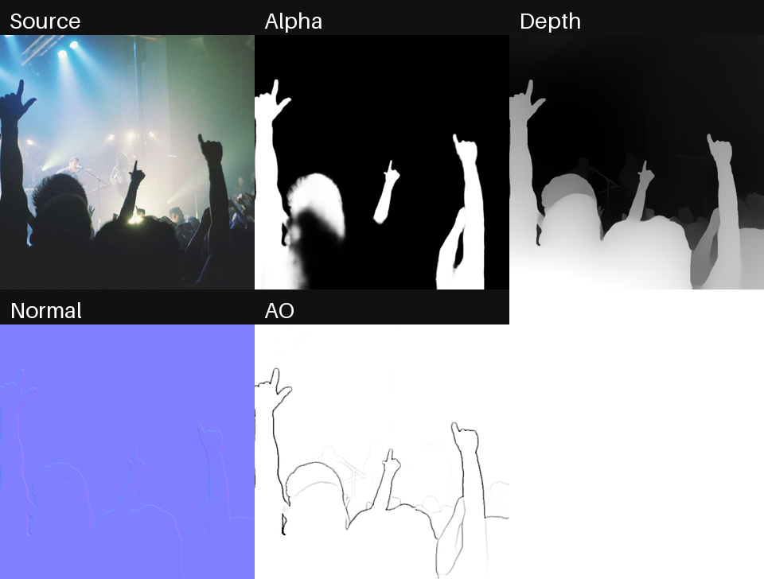

# AMVFX — Open-Source VFX Passes Generator

**Turn any image or video into a rotoscoped, relightable 2.5D VFX asset.**

AMVFX is a free, open-source alternative to Beeble's VFX Pass Generator
(SwitchLight 3.0). It composes published open-source models from Hugging
Face and GitHub into one pipeline that generates the same pass set:

| Pass | What it is |
|---|---|
| **Alpha** | Foreground matte for background replacement |
| **Depth** | Normalized depth map for compositing & 3D integration |
| **Normal** | Surface normals (OpenGL convention) for relighting |
| **Base Color** | Diffuse albedo with lighting removed |
| **Roughness** | Surface roughness for PBR materials |
| **Metallic** | Metallic surface properties |
| **Specular** | Specular F0, derived the standard PBR way: `mix(0.04, basecolor, metallic)` |
| **AO** | Bonus ambient-occlusion approximation from depth |

Outputs match the pro workflow: **PNG sequence per pass**, **MP4 per
pass**, and **16-bit multi-layer EXR** per frame using the same layer
names (`Source`, `Alpha`, `Normal`, `Basecolor`, `Depth`, `Roughness`,
`Metallic`, `Specular`) — ready for Blender, Unreal, Nuke and After
Effects. A Blender loader script is included in `blender/`.

> AMVFX is an independent clean-room project. It uses no Beeble code,
> weights or assets — only open models (see [MODELS.md](MODELS.md) for
> the full stack and license table) orchestrated by original MIT code.

## Two profiles

- **lite** — CPU-friendly ONNX models, no torch. Depth Anything V2 Small
  (Apache-2.0) for depth, BiRefNet (MIT) for alpha, normals + AO derived
  from depth. Runs in this Space and on a laptop.
- **gpu** — adds Marigold diffusion models for base color / roughness /
  metallic and model normals, completing the full 7-pass set. Needs a
  GPU for practical speeds (works on CPU, slowly).

## Install (app + models + add-ons)

The installer sets up the app, a private Python environment and the
local models, and — each behind its own checkbox — drops the **Blender
add-on** into every detected Blender version's addons folder
(auto-enabled) and the **After Effects panel / CEP extension** into
After Effects:

```bash
installer/install.bat        # Windows
./installer/install.sh       # macOS / Linux
```

Checkbox window with a display, prompts in a terminal, or scripted:
`python installer/install.py --yes`. Details: [installer/README.md](installer/README.md).

**Standalone executables:** GitHub Releases carry `AMVFX-Installer`
builds for Windows (`.exe`), macOS and Linux — the same installer,
frozen with PyInstaller, payload included (the machine still needs
Python 3.10+ for the app's environment step). They're built by the
**Release installers** workflow (`.github/workflows/release.yml`):
push a `v*` tag or run it from the Actions tab. Builds are unsigned —
see the workflow/README notes on SmartScreen/Gatekeeper prompts.

**Updating:** once installed, don't reinstall for new versions — open
the app's **Updates** panel, check, and update in place (venv, models
and settings are kept). The installer can also add a **Desktop
shortcut** that opens the app. Daily improvements land on GitHub from
the backlog in [docs/ROADMAP.md](docs/ROADMAP.md), which also parks
bigger tool ideas (rotobrush, matte refinement, ...) as
consideration-only.

## Quick start (CLI)

```bash
pip install -r requirements-lite.txt        # CPU
# or: pip install -r requirements.txt       # full / GPU profile

python -m amvfx footage.mp4 -o out/ --profile lite
python -m amvfx still.jpg  -o out/ --profile gpu \
    --passes source,alpha,depth,normal,basecolor,roughness,metallic,specular
# green/blue-screen footage: classic chroma key instead of the AI matte
python -m amvfx greenscreen.mp4 -o out/ --alpha-backend chroma --key-color green
```

Every job writes `out/manifest.json` recording which model — or which
deterministic derivation — produced each pass, so results are auditable.

What a lite job produces — one real run on `examples/test_portrait.jpg`
(a concert shot), cycled as an animation and as a contact sheet:





Alpha isolates the crowd from the stage, depth puts the crowd near and
the stage far, and the normal + AO passes are derived from that depth —
the same five passes the Blender add-on and the AE panels consume.

## Web app

`app.py` is a Gradio app (this repo doubles as a Hugging Face Space):
upload an image or short clip, pick a profile and passes, download a ZIP
with all sequences, MP4s and EXRs.

## After Effects — `AE/`

Run AMVFX from inside After Effects: a dockable **ScriptUI panel**
(`AE/AMVFX_Panel.jsx`) that generates passes with your local install and
builds a stacked comp from them, plus a full **CEP extension** source
(`AE/cep-extension/`) ready to be signed into a `.zxp`. See
[AE/README.md](AE/README.md) — including why a compiled `.aex` (native
C++ SDK plug-in) is a different deliverable than a script/plugin panel.

## Blender — `Blender Export/`

An installable **Blender add-on** (`Blender Export/AMVFX_Blender_Export.zip`):
point it at a job folder and it builds a plate whose `AMVFX_PBR` node
group wires every pass into the right Principled sockets — Base Color
(×AO), Roughness, Metallic, Specular, Normal via a Normal Map node,
Alpha, and Depth into a Displacement node — with an optional
**Z-Displacement (Z-Depth)** checkbox plus matching Strength/Midlevel
controls on the group node itself. The **Scene Planning** box in the
same panel adds a camera matched to the plate, a ground plane at the
plate's bottom edge, and a **depth-layer stage** that splits the plate
into depth bands on separate planes for 2.5D parallax previews. See
[Blender Export/README.md](Blender%20Export/README.md). The original
one-shot script remains at `blender/amvfx_loader.py`.

## How it compares to Beeble

See [docs/COMPARISON.md](docs/COMPARISON.md) for an honest feature and
gap table — including where Beeble is still ahead (video-native temporal
models, 4K/1-hour throughput, its 3D Relight editor) and the roadmap to
close those gaps with Video Depth Anything, NormalCrafter, MatAnyone 2
and NVIDIA's open Cosmos DiffusionRenderer.

## Tests

```bash
python -m pytest tests/          # full suite (geometry, updater, installer,
                                 # history, preview, trim, keying, app, smoke)
python tests/test_geometry.py    # one file, standalone
```

## License

AMVFX code: MIT (see `LICENSE`). Model weights keep their own licenses —
Apache-2.0, MIT and CreativeML Open RAIL++-M are all in the stack; check
[MODELS.md](MODELS.md) before commercial use.
